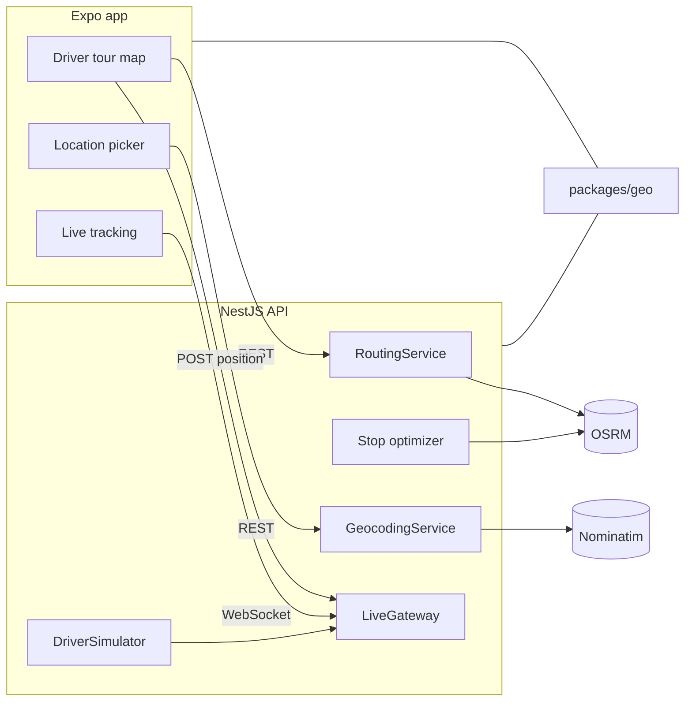

# Delivery Route Tracker

A small courier demo: one driver, a tour of stops, and a tracking code a customer can follow on a map.

The Expo app runs on iOS, Android and the web. The NestJS API plans the route, geocodes addresses and streams the driver over a WebSocket. Maps, routing and geocoding use free OpenStreetMap services, so the project does not need an API key. A mock mode keeps tests and the offline demo deterministic.

## Features

- Driver tour map with stop markers, the route line, and Optimize, Reverse and Recalculate.
- Turn-by-turn leg with off-route detection and a delayed reroute, plus a link out to OpenStreetMap directions.
- Live parcel tracking: animated driver, remaining route, ETA and a connection state.
- Drop-off picker: search, drag the pin, reverse geocode, and save the pin onto a tracking code.
- Optional GPS sharing from a device. On the web, a server-side simulator walks the driver along the route.
- Shared geometry package: polyline encode and decode, haversine, off-route distance, navigation progress and a nearest-neighbour plus 2-opt stop order.

## Architecture



The seeded tour is `tour-paris` (driver `driver-1`). Drop-off codes are `TRK-1001` through `TRK-1006`. Paris is only the sample data in `apps/api/src/tours/seed.ts`.

## Quick start

Requires Node.js 20 or newer.

```bash
npm install
npm run build -w @tracker/geo
cp apps/api/.env.example apps/api/.env
cp apps/mobile/.env.example apps/mobile/.env
npm run dev
```

`npm run dev` starts the API on port 3000 and the web app on port 8081. Open http://localhost:8081.

For a phone, install a dev client (`npx expo start` inside `apps/mobile`, then Expo Go or a development build) and point `EXPO_PUBLIC_API_URL` at your computer's LAN address. Custom OpenStreetMap tiles need a development build on Android and iOS: Expo Go's map view cannot always load a `UrlTile`. The web build is the zero-setup demo.

Android's default map provider is Google Maps and may still ask for a key even when `mapType` is `none`. The native screen hides that base map and draws OSM tiles on top. If the tiles do not appear, create a development build and leave the Google key unset only when the platform allows it. iOS uses Apple Maps under the same tile overlay.

### Docker

```bash
docker compose up --build
```

That serves the API only. Point the app's `EXPO_PUBLIC_API_URL` at `http://localhost:3000`.

## Provider modes

| Variable | Values | Default |
| --- | --- | --- |
| `ROUTING_PROVIDER` | `osrm`, `straight`, `mock` | `osrm` |
| `GEOCODING_PROVIDER` | `nominatim`, `mock` | `nominatim` |
| `SIMULATE_DRIVER` | `true` or `false` | `false` |

`osrm` calls `OSRM_URL` (`/route` and `/trip`). If the request fails, the API falls back to straight lines. `straight` always uses haversine. `mock` is the same geometry with canned durations, for tests.

`nominatim` calls `NOMINATIM_URL` with a `User-Agent`, at most one request per second, and caches results. If it fails, a small Paris gazetteer answers instead. `mock` uses only that gazetteer.

The public OSRM and Nominatim servers are for light, fair use. For anything heavier, run your own and set the URLs:

```bash
OSRM_URL=http://localhost:5000
NOMINATIM_URL=http://localhost:8088
```

[OSRM backend](https://github.com/Project-OSRM/osrm-backend) and [Nominatim](https://nominatim.org/release-docs/latest/admin/Installation/) both publish Docker images. Tests and CI never call those public servers: they set `ROUTING_PROVIDER=mock` and `GEOCODING_PROVIDER=mock`.

`SIMULATE_DRIVER=true` moves `driver-1` along the current route so the tracking screen works without a phone.

## HTTP API

Interactive docs: http://localhost:3000/docs

| Method | Path | Purpose |
| --- | --- | --- |
| `GET` | `/health` | Process status and the active providers |
| `GET` | `/tours` | Seeded tours |
| `GET` | `/tours/:id` | One tour, including its stops and route |
| `GET` | `/tours/:id/route` | Overview polyline, legs and ETAs |
| `POST` | `/tours/:id/optimize` | Reorder stops, keep the depot first, save the new route |
| `POST` | `/tours/:id/reverse` | Reverse the drop-offs, keep the depot first |
| `POST` | `/tours/:id/recalculate` | Rebuild the road geometry for the current order |
| `GET` | `/tours/:id/navigation?stopId&originLat&originLng` | One leg and its steps |
| `GET` | `/tracking/:code` | Destination, latest driver fix, remaining line, ETA |
| `PUT` | `/tracking/:code/location` | Move that drop-off (`lat`, `lng`, optional `label`) |
| `POST` | `/drivers/:id/position` | Driver fix (`lat`, `lng`, optional `heading`). Throttled. |
| `GET` | `/geocode/search?q&limit` | Forward geocode |
| `GET` | `/geocode/reverse?lat&lng` | Reverse geocode |

## WebSocket

Connect to `ws://localhost:3000/live`. Frames are JSON objects `{ "event", "data" }`.

Subscribe:

```json
{ "event": "subscribe", "data": { "trackingCode": "TRK-1001" } }
```

`data` may carry `tourId`, `trackingCode`, or both.

| Event | When |
| --- | --- |
| `subscribed` | The subscription was accepted |
| `error` | The subscription was rejected |
| `driver_position` | A fix was stored for a tour you can hear |
| `eta_updated` | Remaining time for a tracking code changed |
| `route_updated` | The driver drifted off the line and a reroute was allowed |
| `pong` | Reply to `{ "event": "ping" }` |

Reroutes are limited to one per tour per `REROUTE_THROTTLE_MS` (three minutes by default). Positions closer than `POSITION_MIN_MOVE_KM` and sooner than `POSITION_MIN_INTERVAL_MS` are dropped.

## Tests

```bash
npm test          # geo, API and mobile unit tests
npm run test:e2e  # API supertest + WebSocket, mock providers
npm run test:web  # Playwright against the API in mock mode and Expo web
npm run lint
npm run typecheck
```

`npm run test:web` boots the API on port 3099 with the simulator on, then Expo web on port 8081. Install a browser once with `npx playwright install chromium`.

## Screenshots

The web app, with the API in mock mode and the driver simulator on.

| Driver | Track | Pick |
| --- | --- | --- |
|  |  |  |

## Project layout

- `packages/geo` — pure TypeScript shared by the API and the app
- `apps/api` — NestJS 11
- `apps/mobile` — Expo SDK 54, Expo Router, React Query, Zustand
- `e2e` — Playwright

Map data © [OpenStreetMap](https://www.openstreetmap.org/copyright) contributors.

## License

MIT. See [LICENSE](LICENSE).
