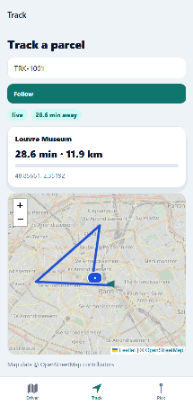
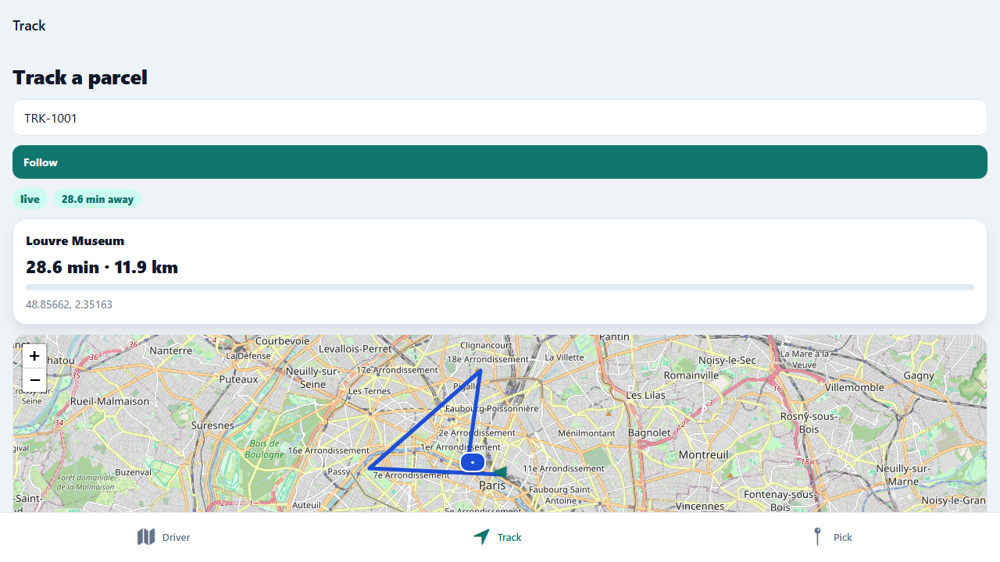
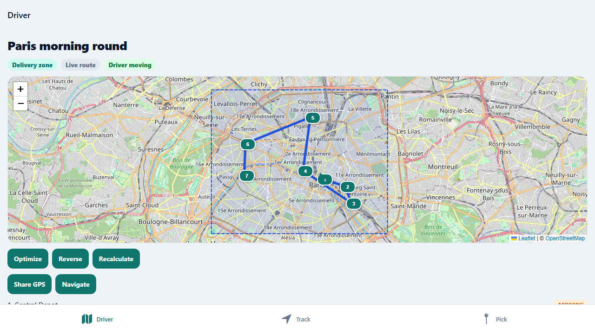
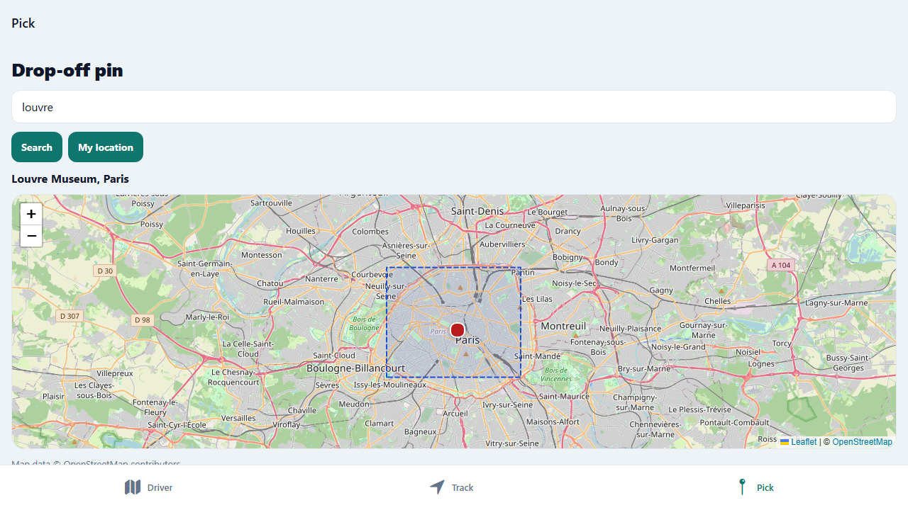
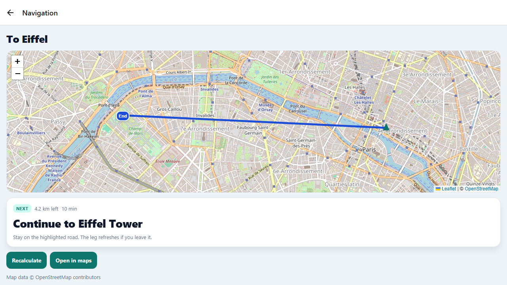
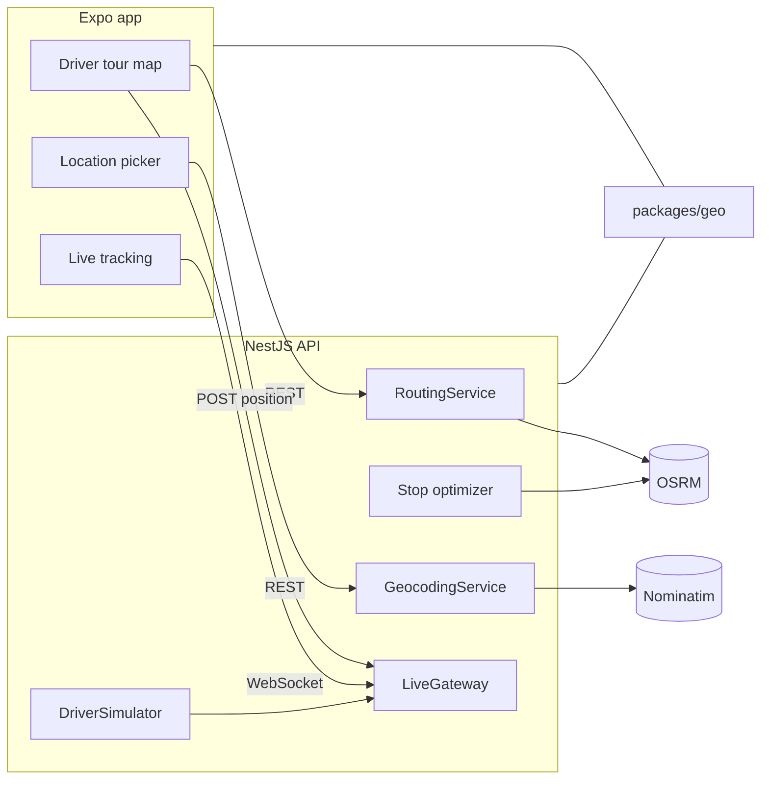

# Delivery Route Tracker

A courier map I can demo on a phone: one driver, a tour of stops, and a tracking code a customer can follow. The map work is React Native on OpenStreetMap, with routing and geocoding from OSRM and Nominatim, so the project does not need an API key.



## Features

**Live tracking.** A WebSocket stream moves the driver, updates the ETA, and draws the road still left. On the web a simulator walks the route, so the screen moves with no phone.



**Route planning.** The driver tour draws the road, numbered stops, and the delivery zone. Optimize, Reverse, and Recalculate reorder the round and rebuild the geometry. The depot stays first.



**Drop-off picker.** Search an address, drag the pin, or tap the map. The pin is reverse-geocoded, and a save is rejected when it falls outside the delivery zone.



**Turn-by-turn.** One leg at a time, with the next instruction, distance left, and a delayed reroute when the driver leaves the line. Open the same leg in OpenStreetMap.



**Geofences.** Every stop has a circle. Entering it marks the stop *arriving* and tells anyone watching that tracking code. Leaving it marks the stop *arrived*. The blue ring is the zone a drop-off must stay inside.

## What I built

- Shared geometry in `packages/geo`: polyline encode and decode, haversine, nearest-neighbour plus 2-opt ordering, off-route distance, navigation progress, circle and polygon geofences, and an enter/exit tracker.
- A NestJS API that calls OSRM and Nominatim, falls back when they fail, and streams driver fixes over a WebSocket. Positions are throttled. Reroutes are limited to one per tour per window.
- An Expo app (SDK 57) with the same map on web (`react-leaflet`) and on iOS/Android (`react-native-maps` with OpenStreetMap tiles, no Google key). Numbered pins, a driver arrow that follows the heading, and a camera that eases toward the driver on the tracking screen.

The seeded tour is `tour-paris` (driver `driver-1`). Drop-off codes are `TRK-1001` through `TRK-1006`. Paris is only the sample data in `apps/api/src/tours/seed.ts`.

## Run it in 2 minutes

Requires Node.js 20 or newer.

```bash
npm install
npm run build -w @tracker/geo
cp apps/api/.env.example apps/api/.env
cp apps/mobile/.env.example apps/mobile/.env
npm run dev
```

On Windows PowerShell, copy the env files with `Copy-Item` instead of `cp`.

`npm run dev` starts the API on port 3000 and the web app on port 8081. Open http://localhost:8081. `SIMULATE_DRIVER=true` in the API env, so the driver moves on its own. Interactive API docs: http://localhost:3000/docs.

### On a phone

The app matches current Expo Go (SDK 57). From `apps/mobile`:

```bash
npx expo start
```

Set `EXPO_PUBLIC_API_URL` in `apps/mobile/.env` to your computer's LAN address, for example `http://192.168.1.4:3000`, not `localhost`. The API listens on all interfaces. Scan the QR code with Expo Go.

Custom OpenStreetMap tiles need a development build on Android and iOS when Expo Go's map view cannot load a `UrlTile`. The web build is the zero-setup demo. Android's default map provider is Google Maps and may still ask for a key even when `mapType` is `none`. The native screen hides that base map and draws OSM tiles on top.

### Docker

```bash
docker compose up --build
```

That serves the API only, with the simulator on. Point `EXPO_PUBLIC_API_URL` at `http://localhost:3000`.

## Architecture



## Provider modes

| Variable | Values | Default |
| --- | --- | --- |
| `ROUTING_PROVIDER` | `osrm`, `straight`, `mock` | `osrm` |
| `GEOCODING_PROVIDER` | `nominatim`, `mock` | `nominatim` |
| `SIMULATE_DRIVER` | `true` or `false` | `true` |

`osrm` calls `OSRM_URL` (`/route` and `/trip`). If the request fails, the API falls back to straight lines. `straight` always uses haversine. `mock` is the same geometry with canned durations, for tests.

`nominatim` calls `NOMINATIM_URL` with a `User-Agent`, at most one request per second, and caches results. If it fails, a small Paris gazetteer answers instead. `mock` uses only that gazetteer.

The public OSRM and Nominatim servers are for light, fair use. For anything heavier, run your own and set the URLs:

```bash
OSRM_URL=http://localhost:5000
NOMINATIM_URL=http://localhost:8088
```

[OSRM backend](https://github.com/Project-OSRM/osrm-backend) and [Nominatim](https://nominatim.org/release-docs/latest/admin/Installation/) both publish Docker images. Tests and CI never call those public servers: they set `ROUTING_PROVIDER=mock` and `GEOCODING_PROVIDER=mock`.

## HTTP API

| Method | Path | Purpose |
| --- | --- | --- |
| `GET` | `/health` | Process status and the active providers |
| `GET` | `/tours` | Seeded tours |
| `GET` | `/tours/:id` | One tour, including its stops, delivery zone, and route |
| `GET` | `/tours/:id/route` | Overview polyline, legs and ETAs |
| `POST` | `/tours/:id/optimize` | Reorder stops, keep the depot first, save the new route |
| `POST` | `/tours/:id/reverse` | Reverse the drop-offs, keep the depot first |
| `POST` | `/tours/:id/recalculate` | Rebuild the road geometry for the current order |
| `GET` | `/tours/:id/navigation?stopId&originLat&originLng` | One leg and its steps |
| `GET` | `/tracking/:code` | Destination, latest driver fix, remaining line, ETA |
| `PUT` | `/tracking/:code/location` | Move that drop-off. `400` when the pin is outside the delivery zone |
| `POST` | `/drivers/:id/position` | Driver fix (`lat`, `lng`, optional `heading`). Throttled. |
| `GET` | `/geocode/search?q&limit` | Forward geocode |
| `GET` | `/geocode/reverse?lat&lng` | Reverse geocode |

## WebSocket

Connect to `ws://localhost:3000/live`. Frames are JSON objects `{ "event", "data" }`.

```json
{ "event": "subscribe", "data": { "trackingCode": "TRK-1001" } }
```

`data` may carry `tourId`, `trackingCode`, or both.

| Event | When |
| --- | --- |
| `subscribed` | The subscription was accepted |
| `error` | The subscription was rejected |
| `driver_position` | A fix was stored for a tour you can hear |
| `eta_updated` | Remaining time for a tracking code changed |
| `route_updated` | The driver drifted off the line and a reroute was allowed |
| `geofence` | The driver entered or left a stop circle (`type` is `enter` or `exit`) |
| `pong` | Reply to `{ "event": "ping" }` |

A `geofence` frame looks like `{ "tourId", "stopId", "trackingCode", "type" }`. Reroutes are limited to one per tour per `REROUTE_THROTTLE_MS` (three minutes by default). Positions closer than `POSITION_MIN_MOVE_KM` and sooner than `POSITION_MIN_INTERVAL_MS` are dropped.

## Tests

```bash
npm test          # geo, API and mobile unit tests
npm run test:e2e  # API supertest + WebSocket, mock providers
npm run test:web  # Playwright against the API in mock mode and Expo web
npm run lint
npm run typecheck
```

`npm run test:web` boots the API on port 3099 with the simulator on, then Expo web on port 8081. Install a browser once with `npx playwright install chromium`.

## Project layout

- `packages/geo` — pure TypeScript shared by the API and the app
- `apps/api` — NestJS 11
- `apps/mobile` — Expo SDK 57, Expo Router, React Query, Zustand
- `e2e` — Playwright

Map data © [OpenStreetMap](https://www.openstreetmap.org/copyright) contributors.

## License

MIT. See [LICENSE](LICENSE).
